# KeenPG Console

The KeenPG console is a web page for running PostgreSQL on Kubernetes and OpenShift. You can create databases, take backups, restore, run SQL and watch health from your browser, with no YAML and no command line.

## How it works

```
You (browser) → KeenPG console → Kubernetes → KeenPG operator → your PostgreSQL clusters
```

1. You fill a form or press a button in the console.
2. The console checks your permissions and saves the request in Kubernetes as a `KeenPGCluster`.
3. The KeenPG operator sees it and creates everything the database needs: pods, disks, services, passwords, certificates and backup jobs.
4. The operator keeps watching. If something breaks or is deleted, it puts it back.

If the console stops, your databases keep running. If the operator stops, your databases also keep running, and failover still works.

## Words to know

| Word | Meaning |
|---|---|
| Project | A group of databases (a Kubernetes namespace). |
| Cluster | One PostgreSQL service: a primary plus replicas. |
| Primary | The main server. All writes go here. |
| Replica | A live copy of the primary. It takes over if the primary fails. |
| Failover | A replica becomes primary automatically. |
| Switchover | You move the primary role on purpose. |
| Repository | Where backups are stored: a disk, or S3 / GCS / Azure. |

## Install

1. Get the files:
   ```bash
   git clone -b keenpgo-ui-6.0 https://github.com/keenpg/keenpg-operator.git
   cd keenpg-operator
   ```
2. Add the image registry login (needed, because the images are private):
   ```bash
   podman login quay.io --authfile config/keenpg/pull-secret.json
   ```
3. Install everything with one command:
   ```bash
   kubectl apply --server-side -k config/keenpg
   kubectl -n keenpg-operator get pods      # wait until all are Running
   ```
4. Open `http://<node IP>:30080` in your browser. On minikube, run `minikube service keenpgo-console -n keenpg-operator --url`.

## Sign in

The first login is `admin` / `admin`. Change the password straight away: click your name (top right) → **Change password**.

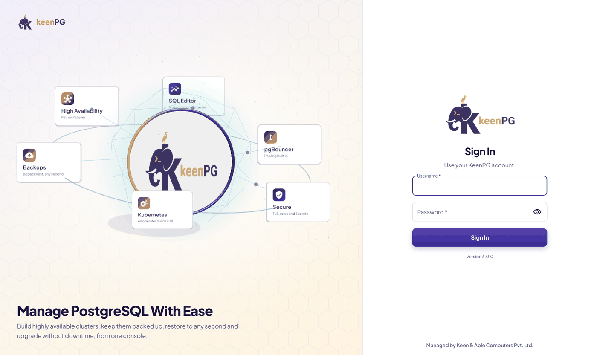

## Pages

| Page | What you can do |
|---|---|
| **Home** | See the health of all clusters, recent activity, and shortcuts. |
| **Clusters** | List your clusters and open one. |
| **SQL Editor** | Run SQL on any database. Press **F5** or **Ctrl+Enter** to run, and export results as CSV. |
| **Databases** | Manage databases, users and access, schemas, extensions and sessions, and run VACUUM / ANALYZE / REINDEX. |
| **Observability** | Live health of every cluster: connections, lag, cache hit, Patroni state. |
| **Discovery** | Find other PostgreSQL running in your Kubernetes (Crunchy, Percona, CloudNativePG and more). |
| **Migration** | Move Crunchy PGO or Percona clusters into KeenPG from their backups. The source is not changed. |
| **Backup & Restore** | See backups and schedules, back up now, restore, or clone. |
| **Secrets & keys** | Create registry logins, S3 / GCS / Azure credentials, or TLS keys. Database passwords are made for you. |
| **Operations** | All backup jobs and events in one list. |
| **Settings** | Projects, users and access, operator info, storage, and the audit log. |

**Home**

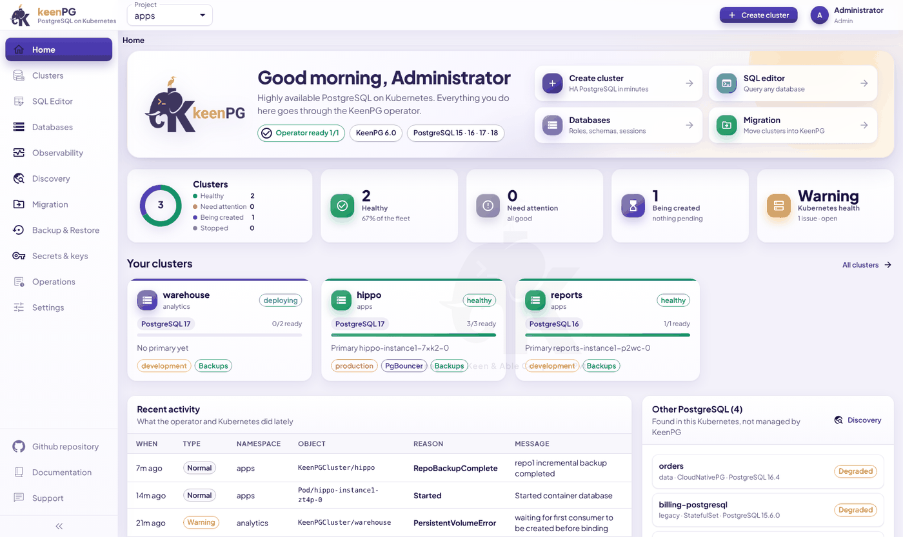

**Clusters**

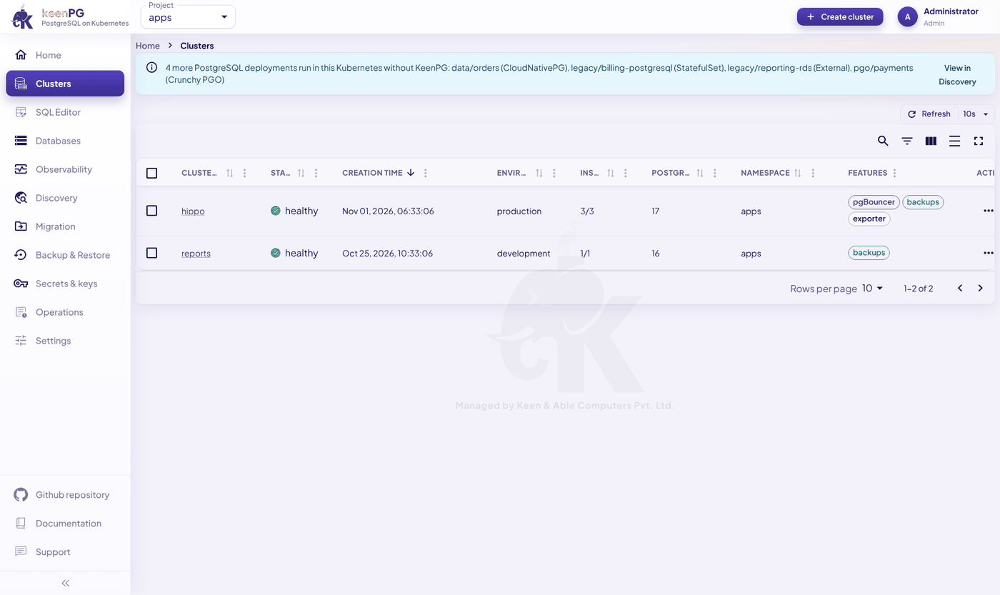

**SQL Editor**

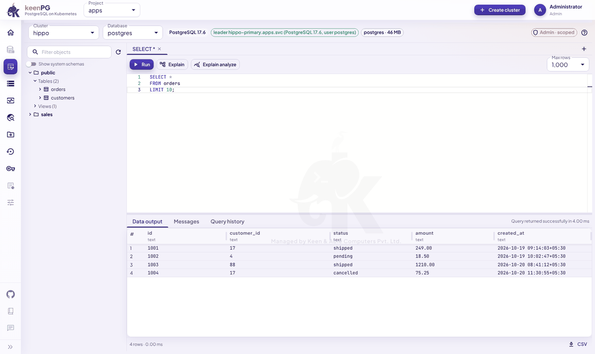

**Databases**

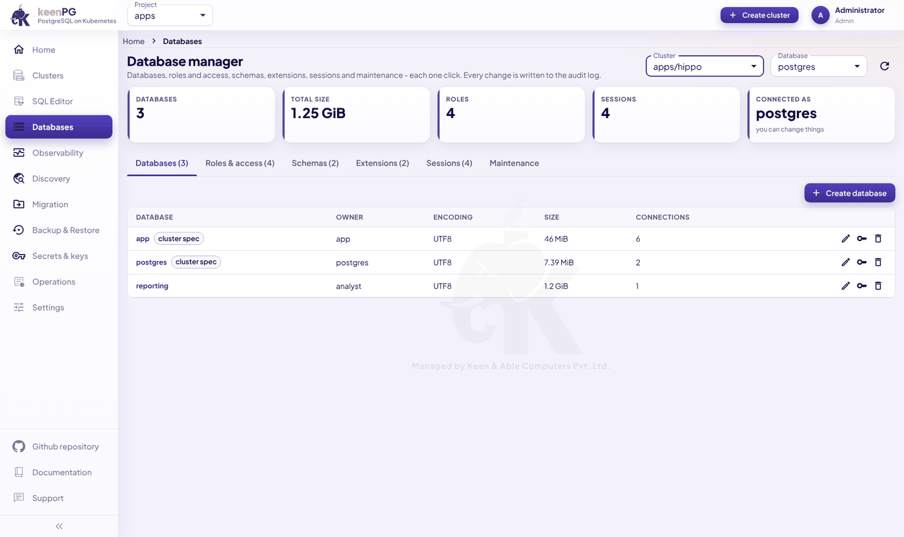

**Observability**

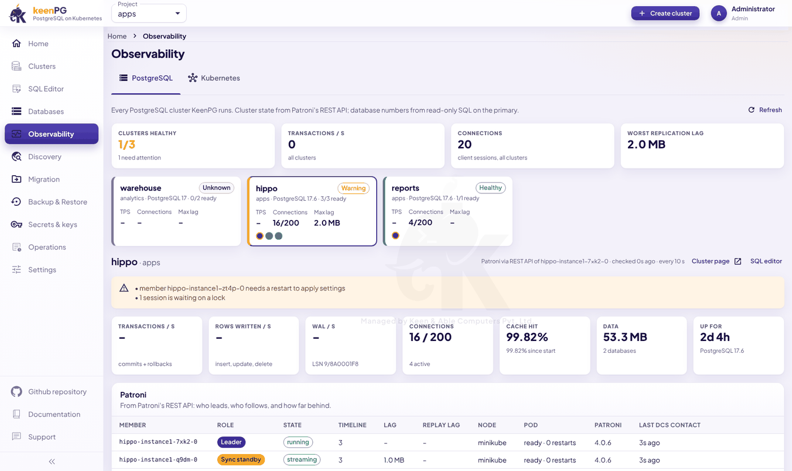

**Discovery**

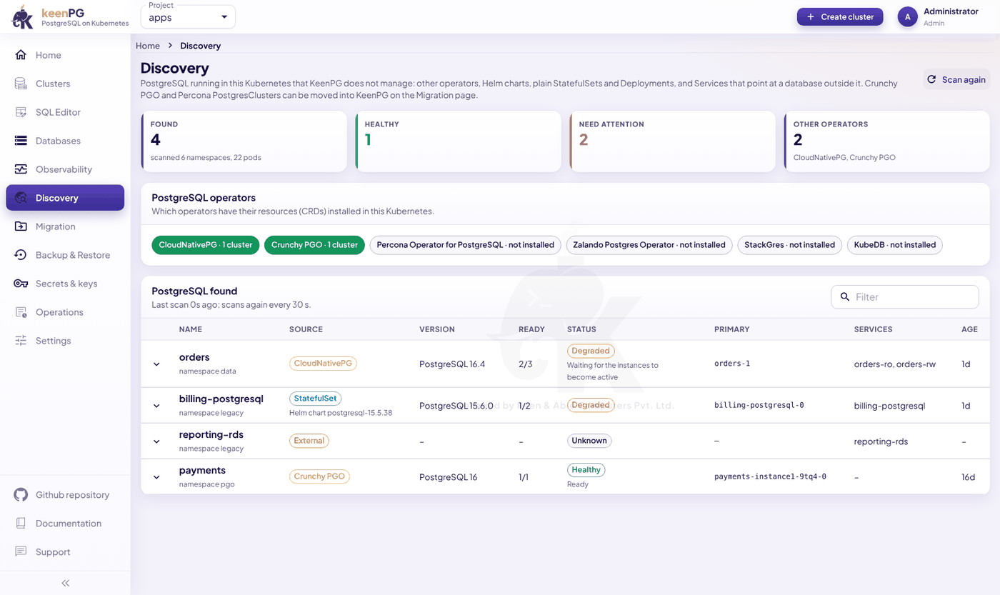

**Migration**

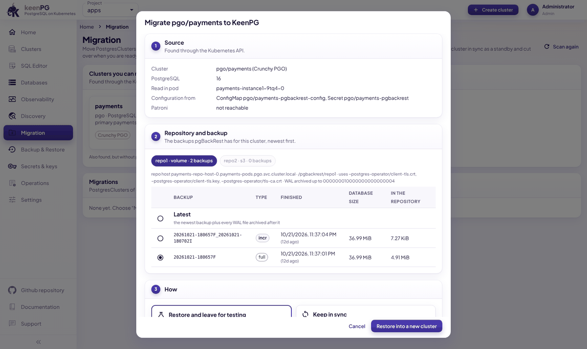

**Settings → Users**

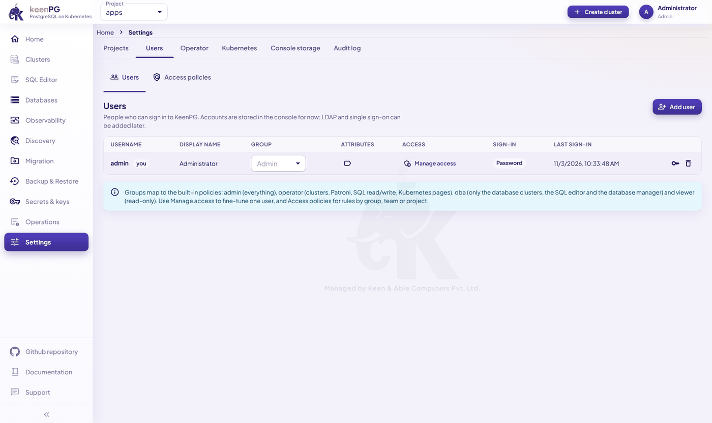

## Create a cluster

1. Click **Create cluster** (top right).
2. Choose a **project** and a **name** (lowercase letters, digits and `-`).
3. Choose the **PostgreSQL version** (15–18).
4. Choose the **number of pods**: 1 means no high availability; use 2 or more for production. Pick a size: **Small**, **Medium** or **Large**.
5. Keep **backups** on, and set the schedule if you need to.
6. Optional: turn on PgBouncer, choose how the database can be reached, and add users and settings.
7. Click **Create cluster**. It is usually ready in 2–5 minutes.

You don't need to make any passwords: the operator creates them.

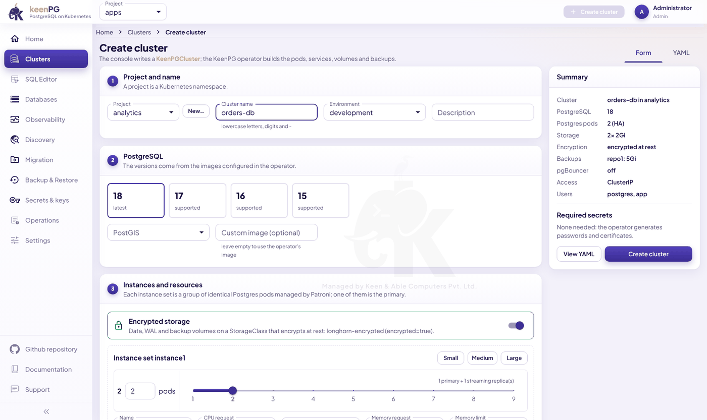

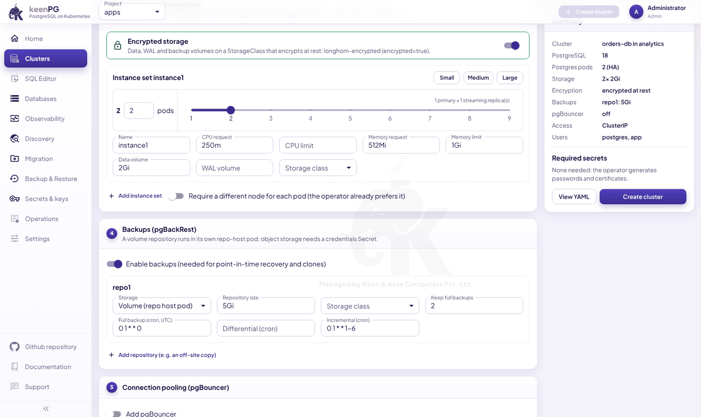

## Inside a cluster

| Tab | What it shows |
|---|---|
| **Overview** | Members, roles, lag, and the Patroni buttons (switchover, restart, reinit). |
| **Backup & Restore** | Backups, schedules and jobs. |
| **Users & databases** | Users, and a **Connection** button with the host, port, password and URI. |
| **Configuration** | PostgreSQL settings and `pg_hba` rules. |
| **Metrics** | Connections, cache hit, replication, slow queries. |
| **Pods & logs** | Pods and their logs. |
| **Events** | What went wrong, newest first. |
| **YAML** | The full definition, which you can edit. |

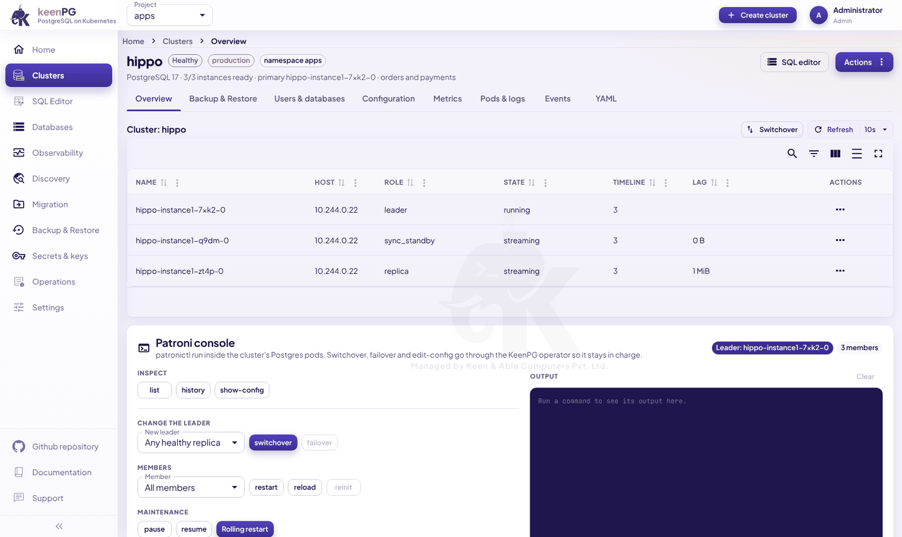

The **Actions** menu has: Switchover, Rolling restart, Back up now, Stop / Start, Suspend / Resume, Clone, and Delete.

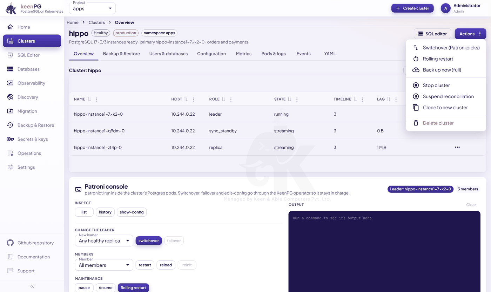

## Connect your application

Open the cluster → **Users & databases** → **Connection**.

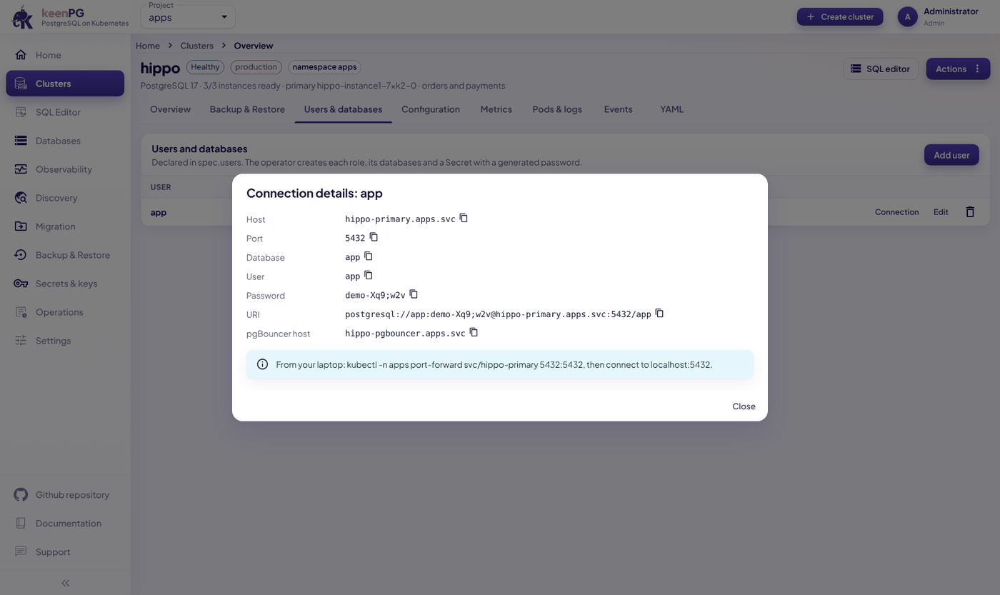

- **Inside Kubernetes:** `postgresql://<user>:<password>@<cluster>-primary.<project>.svc:5432/<database>`
- **From your laptop:** run `kubectl -n <project> port-forward svc/<cluster>-primary 5432:5432`, then connect to `localhost:5432`.
- **The password** is also in the Secret `<cluster>-pguser-<user>`.

`<cluster>-primary` always points to the current primary, even after a failover.

## Backup and restore

- **Back up now:** starts a full backup at once.
- **Restore in place:** replaces **all** data with a backup, to the latest point or to a time you choose.
- **Clone to new cluster:** makes a new cluster from a backup. The original is not touched. Use this when you are not sure.

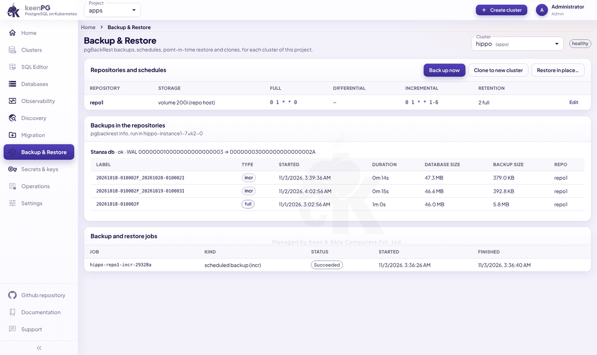

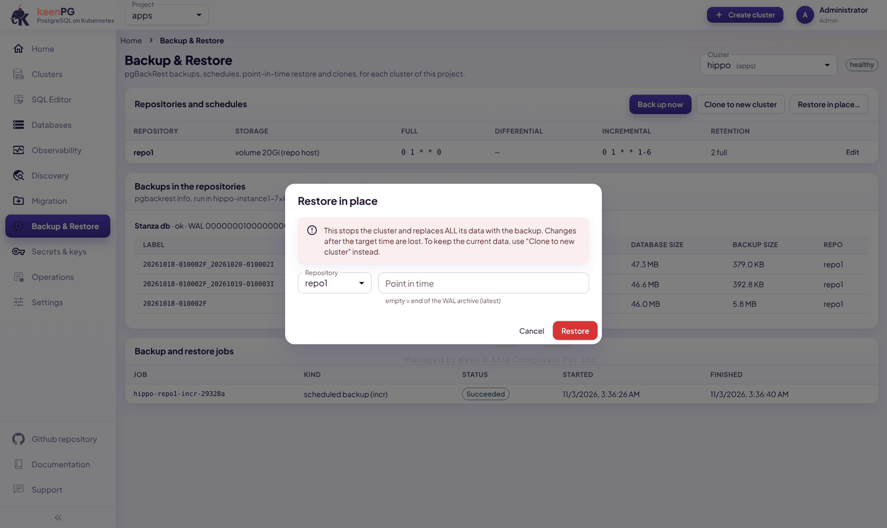

## Who can do what

| Group | Can do |
|---|---|
| Admin | Everything. |
| Operator | Clusters, backups, Secrets, Kubernetes pages, migration, SQL read/write. |
| DBA | Database clusters, the SQL editor and the database manager only. |
| Viewer | Read only. |

Admins can fine-tune access in **Settings → Users** and **Access policies**.

## Troubleshooting

| Problem | Fix |
|---|---|
| Pods show **ImagePullBackOff** / **401** | The registry login is missing. Repeat install step 2, apply again, then delete the stuck pods. |
| A pod stays **Pending** | No disk could be made. Check **Settings → Kubernetes** for a StorageClass. |
| The cluster stays "deploying" | Look at the cluster's **Events** and **Pods & logs** tabs. |
| A replica is far behind | Overview → Patroni console → pick the member → **reinit**. |
| You can't sign in | Ask an admin to reset your password in **Settings → Users**. |

## Be careful

- **Delete cluster** removes its disks and the backups in its volume repositories. This can't be undone.
- **Restore in place** replaces all data. If in doubt, clone instead.
- Use **2 or more pods** for production, and keep **backups on**.
