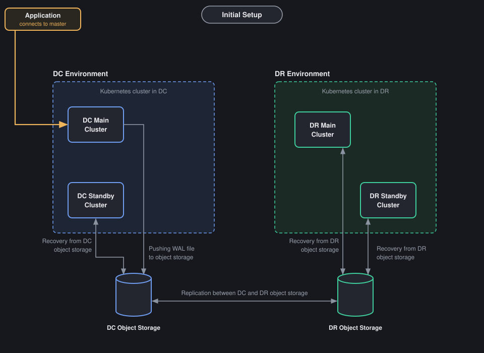
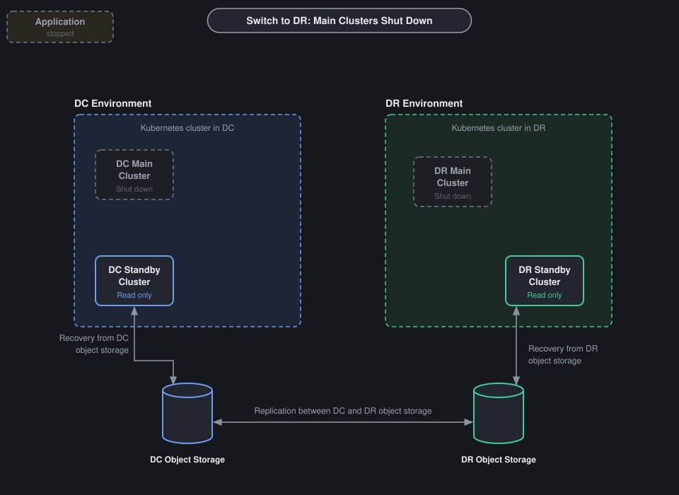
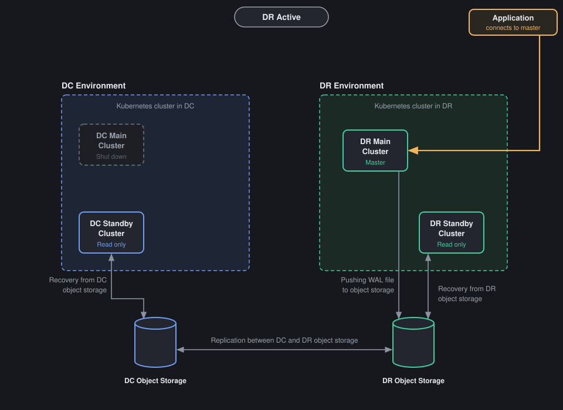
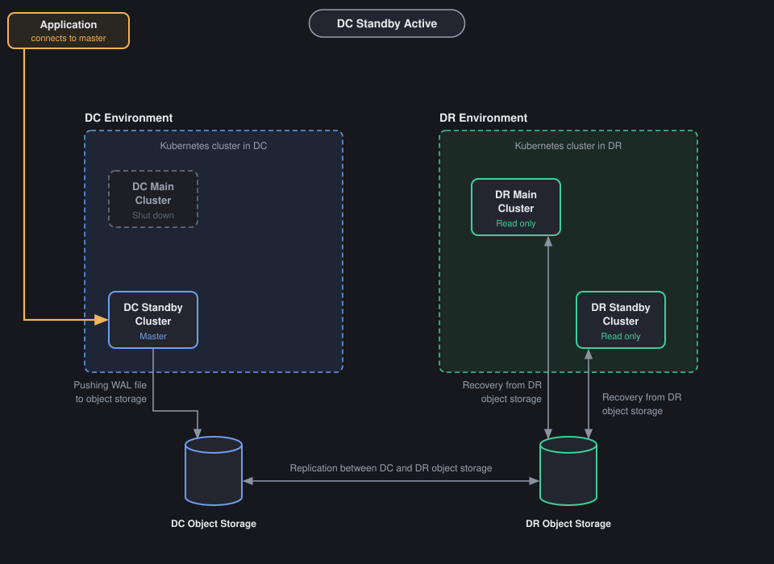

# DC / DR setup and DR drill

This page tells how our keenPGO database runs on two sites, DC and DR.
It also tells how to do the DR drill, step by step.
First we move the database from DC to DR.
Then we bring it back from DR to DC with the same method.

## Who should read this

- **Platform engineers** who set up the DC and DR clusters
- **DBAs** who run the DR drill
- **On-call engineers** who need the steps during a real problem

## Initial setup



- One **keenPGO operator** is on top and manages everything.
- DC and DR are two different Kubernetes clusters.
- Each site has two database clusters:
    - **Main cluster.** Primary and replica pods.
      DC main is in namespace `demo-dc`, DR main is in namespace `demo-dr`.
    - **Standby cluster.** One pod, read only, in its own namespace.
      It always recovers from the object storage of its own site.
- Each site has its own **object storage**.
- The two object storages replicate both ways (like master - master).
- DC main cluster is the only one that takes writes.
  It pushes WAL files to DC object storage.
- DC standby cluster recovers from DC object storage.
- The WAL is copied to DR object storage.
  DR main cluster and DR standby cluster both recover from it.
- DR main cluster has the same number of pods as DC main, but it is read only.

### Why we need a standby cluster

- HA inside one site (primary + replicas) only saves us when a pod or a node fails.
- If the full DC goes down (power, network, storage or Kubernetes problem), all pods go down together.
- The standby cluster has a full copy of the data, kept up to date from object storage.
- It is already running and replaying WAL, so we can promote in minutes.
  Restore from backup can take hours for a big database.
- Data loss is small, because WAL is shipped all the time, not once a day.
- Standby is read only, so nobody can write on it by mistake.
- During the drill, when the DC main cluster is shut down, the DC standby cluster still
  keeps a live copy of the data on the DC side.
- Before we switch back, we check the data on the DC standby cluster.
- We can run reports and read-only queries on a standby.

!!! note "Standby cluster is not a backup"
    If someone drops a table on the main cluster, it is dropped on all standbys also.
    For this we still need backups and point-in-time restore.

### Which main cluster is active

The `standby` setting in the main cluster decides which site is active.

| State | DC main `standby.enabled` | DR main `standby.enabled` | Apps write to |
|---|---|---|---|
| Normal (DC active) | `false` | `true` | DC main |
| DR active | `true` (and shut down) | `false` | DR main |

The standby clusters on both sites always have `standby.enabled: true`.

When DC is active, the DC main kustomize file has:

```yaml
spec:
  standby:
    enabled: false
```

And the DR main kustomize file has:

```yaml
spec:
  standby:
    enabled: true
    repoName: <repo that points at DR object storage>
```

!!! warning "Only one main cluster can have `standby.enabled: false`"
    If both main clusters are primary at the same time, both take writes and the data
    becomes different on both sides (split brain).
    So we always shut down the old main cluster first, and only then promote the other one.

## DR drill: switch from DC to DR

Do these steps one by one. Do not skip any step.

### Step 1 - Shut down the application

Stop all applications that connect to the DC main cluster.
Scale the app deployments to 0, or stop them in the way your team does it.

```bash
kubectl scale deployment <app-deployment> -n <app-namespace> --replicas=0
```

If you use pgBouncer, stop it also, so no new connection comes.

### Step 2 - Check connections, close them, then switch WAL

Find the primary pod of the DC main cluster:

```bash
kubectl exec -it <any-db-pod> -n demo-dc -- patronictl list
```

The pod with role `Leader` is the primary.

Connect to the primary:

```bash
kubectl exec -it <dc-primary-pod> -n demo-dc -- psql -U postgres
```

Check who is still connected:

```sql
SELECT pid, usename, datname, client_addr, application_name, state
FROM pg_stat_activity
WHERE backend_type = 'client backend'
  AND pid <> pg_backend_pid();
```

If any app connection is still there, close it:

```sql
SELECT pg_terminate_backend(pid)
FROM pg_stat_activity
WHERE backend_type = 'client backend'
  AND pid <> pg_backend_pid();
```

Add one test row, so we can check later that DR has all the data:

```sql
CREATE TABLE IF NOT EXISTS dr_drill_check (checked_at timestamptz, note text);
INSERT INTO dr_drill_check VALUES (now(), 'before DC shutdown');
```

Now take a checkpoint and switch WAL, so the last WAL file goes to object storage:

```sql
CHECKPOINT;
SELECT pg_switch_wal();
SELECT pg_current_wal_lsn();
```

Write down the LSN from the last command. We need it in step 4.

Check that the WAL is archived and there is no failure:

```sql
SELECT last_archived_wal, last_archived_time, failed_count, last_failed_wal
FROM pg_stat_archiver;
```

`last_archived_time` should be just now.
If `failed_count` goes up, stop here and fix archiving first.

### Step 3 - Shut down the DC main cluster

```bash
kubectl patch keenpgcluster/demo-dc-db-pod -n demo-dc --type merge --patch '{"spec":{"shutdown": true}}'
```

Expected output:

```text
keenpgcluster.<api-group>/demo-dc-db-pod patched
```

Check that the database pods are gone:

```bash
kubectl get pods -n demo-dc
```

Expected output (no database pods; backup or other helper pods can still be there):

```text
No resources found in demo-dc namespace.
```

Now, for safety, set DC main to standby in the DC main kustomize file.
So if somebody starts it by mistake, it comes up read only, not as a second primary.

```yaml
spec:
  standby:
    enabled: true
    repoName: <repo that points at DC object storage>
```

```bash
kubectl apply -k <dc-main-kustomize-path>
```

Expected output:

```text
keenpgcluster.<api-group>/demo-dc-db-pod configured
```

Do not touch the DC standby cluster. It keeps running and recovering from DC object storage.

### Step 4 - Check sync on DR, then shut down the DR main cluster

First check that the DR main cluster has all the data from DC.

Connect to the DR main standby leader:

```bash
kubectl exec -it <any-db-pod> -n demo-dr -- patronictl list
kubectl exec -it <dr-standby-leader-pod> -n demo-dr -- psql -U postgres
```

Check that it is still a standby:

```sql
SELECT pg_is_in_recovery();
```

It should say `t`.

Check how much WAL is replayed:

```sql
SELECT pg_last_wal_replay_lsn(), pg_last_xact_replay_timestamp();
SELECT pg_wal_lsn_diff('<lsn-from-step-2>', pg_last_wal_replay_lsn());
```

The second query should give `0` or a negative number.
If it gives a positive number, DR is still behind. Wait and check again.

Check the test row:

```sql
SELECT * FROM dr_drill_check ORDER BY checked_at DESC LIMIT 1;
```

You should see the row `before DC shutdown`.
You can run the same checks on the DC standby cluster and the DR standby cluster also.

When sync is OK, shut down the DR main cluster before promotion:

```bash
kubectl patch keenpgcluster/demo-dr-db-pod -n demo-dr --type merge --patch '{"spec":{"shutdown": true}}'
```

Expected output:

```text
keenpgcluster.<api-group>/demo-dr-db-pod patched
```

Now both main clusters are down. Nobody can write.
Only the two standby clusters are running.



### Step 5 - Promote DR main and start it

Set standby to false in the DR main kustomize file:

```yaml
spec:
  standby:
    enabled: false
```

Apply the kustomize:

```bash
kubectl apply -k <dr-main-kustomize-path>
```

Expected output:

```text
keenpgcluster.<api-group>/demo-dr-db-pod configured
```

Start the DR main cluster:

```bash
kubectl patch keenpgcluster/demo-dr-db-pod -n demo-dr --type merge --patch '{"spec":{"shutdown": false}}'
```

Expected output:

```text
keenpgcluster.<api-group>/demo-dr-db-pod patched
```

Watch the pods come up:

```bash
kubectl get pods -n demo-dr --watch
```

Check that DR main is now primary:

```bash
kubectl exec -it <any-db-pod> -n demo-dr -- patronictl list
```

One pod should have role `Leader` (not `Standby Leader`).
In psql, `SELECT pg_is_in_recovery();` should now say `f`.

### Step 6 - Point the apps to DR and start them

- Change the DNS or connection string to the DR main primary service.
- Start the apps and pgBouncer.
- Do a small write test and check the app is working.
- Check that new WAL and backups go to DR object storage.

This is how it looks now:



- DR main cluster is primary and pushes WAL to DR object storage.
- DR standby cluster recovers from DR object storage.
- DC main cluster is shut down.
- On the DC side only the DC standby cluster (1 pod) is running.
  It recovers DR WAL from DC object storage, which comes by the both-way replication.

## DR drill: switch back from DR to DC

We use the same method, only the sites are opposite.

### Step 1 - Shut down the application

Stop all apps and pgBouncer that connect to the DR main cluster.

```bash
kubectl scale deployment <app-deployment> -n <app-namespace> --replicas=0
```

### Step 2 - Check connections, close them, then switch WAL

Connect to the DR main primary:

```bash
kubectl exec -it <dr-primary-pod> -n demo-dr -- psql -U postgres
```

Close any open app connection (same queries as before):

```sql
SELECT pg_terminate_backend(pid)
FROM pg_stat_activity
WHERE backend_type = 'client backend'
  AND pid <> pg_backend_pid();
```

Add the test row, switch WAL and note the LSN:

```sql
INSERT INTO dr_drill_check VALUES (now(), 'before DR shutdown');
CHECKPOINT;
SELECT pg_switch_wal();
SELECT pg_current_wal_lsn();
SELECT last_archived_wal, last_archived_time, failed_count FROM pg_stat_archiver;
```

### Step 3 - Shut down the DR main cluster

```bash
kubectl patch keenpgcluster/demo-dr-db-pod -n demo-dr --type merge --patch '{"spec":{"shutdown": true}}'
```

Expected output:

```text
keenpgcluster.<api-group>/demo-dr-db-pod patched
```

For safety, set DR main back to standby in the DR main kustomize file and apply it:

```yaml
spec:
  standby:
    enabled: true
    repoName: <repo that points at DR object storage>
```

```bash
kubectl apply -k <dr-main-kustomize-path>
```

### Step 4 - Check sync on the DC standby cluster, then shut it down

Do not start the DC main cluster. It stays shut down.
We come back on the DC standby cluster, because it was running the whole time and has the latest data.


Connect to the DC standby cluster:

```bash
kubectl exec -it <dc-standby-pod> -n <dc-standby-namespace> -- psql -U postgres
```

Check the data:

```sql
SELECT pg_is_in_recovery();
SELECT pg_wal_lsn_diff('<lsn-from-step-2>', pg_last_wal_replay_lsn());
SELECT * FROM dr_drill_check ORDER BY checked_at DESC LIMIT 1;
```

- `pg_is_in_recovery()` should be `t`.
- The LSN diff should be `0` or negative.
- You should see the row `before DR shutdown`.

Also check the logs for any WAL or timeline error:

```bash
kubectl logs <dc-standby-pod> -n <dc-standby-namespace> --tail=100
```

When everything is OK, shut down the DC standby cluster before promotion:

```bash
kubectl patch keenpgcluster/<dc-standby-cluster> -n <dc-standby-namespace> --type merge --patch '{"spec":{"shutdown": true}}'
```

Expected output:

```text
keenpgcluster.<api-group>/<dc-standby-cluster> patched
```

### Step 5 - Promote the DC standby cluster and start it

In the DC standby kustomize file set standby to false:

```yaml
spec:
  standby:
    enabled: false
```

Apply the kustomize:

```bash
kubectl apply -k <dc-standby-kustomize-path>
```

Expected output:

```text
keenpgcluster.<api-group>/<dc-standby-cluster> configured
```

Start it:

```bash
kubectl patch keenpgcluster/<dc-standby-cluster> -n <dc-standby-namespace> --type merge --patch '{"spec":{"shutdown": false}}'
```

Check that it is now the master:

```bash
kubectl exec -it <dc-standby-pod> -n <dc-standby-namespace> -- patronictl list
```

The pod should have role `Leader` (not `Standby Leader`).
In psql, `SELECT pg_is_in_recovery();` should now say `f`.

### Step 6 - Point the apps to the DC standby cluster and start them

- Change the DNS or connection string to the primary service of the DC standby cluster.
- Start the apps and pgBouncer, and do a small write test.
- Check that new WAL goes to DC object storage.
- Start DR main again. It comes up as standby, because we set `standby: true` in step 3:

```bash
kubectl patch keenpgcluster/demo-dr-db-pod -n demo-dr --type merge --patch '{"spec":{"shutdown": false}}'
```

This is how it looks now:



- DC standby cluster is now the master. The application connects to it.
- It pushes WAL to DC object storage.
- DR main and DR standby recover from DR object storage.
- DC main cluster is still shut down.

!!! note "Recreate the DC main cluster as standby"
    The DC standby cluster is now the current master.
    The old DC main cluster is shut down and its data is old (it is on the old timeline).
    Do not start it as it is, and never set `standby: false` on it.

    Recreate it as a standby of the current master:

    1. Keep `shutdown: true` on `demo-dc-db-pod`.
    2. Delete the old DC main cluster and its data volumes (PVCs).
    3. In the DC main kustomize file set `standby.enabled: true` and `repoName` pointing at DC object storage.
    4. Apply the kustomize and set `shutdown: false`.
    5. It restores from the latest backup in DC object storage and then keeps recovering WAL.
    6. Check `pg_is_in_recovery()` is `t` and the lag is small.

    Now the DC main cluster is the standby, and the DC standby cluster is the master.
    For the next drill, use these new roles.

## Quick reference

| Step | DC → DR | DR → DC |
|---|---|---|
| 1 | Stop apps on DC | Stop apps on DR |
| 2 | Close connections, switch WAL on DC main | Close connections, switch WAL on DR main |
| 3 | Shut down DC main, set `standby: true` | Shut down DR main, set `standby: true` |
| 4 | Check sync on DR main, shut down DR main | Check sync on DC standby, shut down DC standby |
| 5 | DR main `standby: false`, apply kustomize, start | DC standby `standby: false`, apply kustomize, start |
| 6 | Apps → DR main | Apps → DC standby, start DR main as standby |
| 7 | | Recreate DC main as standby |

## Why the drill can fail

These are the common reasons. Check them before the drill.

- **Apps are not fully stopped.** Some writes come after the WAL switch, and the other side misses them.
- **WAL archiving is failing.** Wrong bucket keys or a full bucket. `failed_count` in `pg_stat_archiver` goes up.
- **Object storage replication is slow or broken.** The last WAL file did not reach the other site yet.
- **Standby is not replaying.** Wrong `repoName`, a missing WAL file, or the standby was already behind before the drill.
- **We forgot `standby: true` on the old main cluster.** When it starts again, both sides are primary (split brain).
- **Kustomize file not updated.** Wrong path, or the change is not saved in git, so a sync tool puts the old value back.
- **Operator is not working.** The patch is accepted, but nothing happens to the pods.
- **Pods stay Pending on the other site.** Not enough nodes, CPU or memory, PVC or storage class problem, or anti-affinity cannot be met.
- **Timeline problem when coming back.** After DR main is promoted it starts a new timeline. If the DC standby cluster cannot follow it, it must be rebuilt from a DR backup.
- **Old DC main started by mistake.** Its data is old. It must be recreated as standby, never started as primary.
- **Users or secrets are different on the two sites.** Apps cannot log in after the switch.
- **Apps still point to the old site.** DNS TTL is long, or pgBouncer or the app has the old address cached.
- **Network or firewall issue** between a site and its object storage.
- **Long running sessions** keep coming back, so the shutdown takes too long.

## DR checklist

- [ ] keenPGO operator manages all four clusters (DC main, DC standby, DR main, DR standby)
- [ ] DC main has `standby.enabled: false`, all others have `standby.enabled: true`
- [ ] DR main has the same number of pods as DC main, and enough nodes
- [ ] Both object storages are working and replicate both ways
- [ ] WAL archiving has no failures and standby lag is small
- [ ] WAL retention is long enough to cover the full drill time
- [ ] Kustomize paths for both main clusters are known and in git
- [ ] App connection strings can be changed quickly
- [ ] Drill is done in a test environment first, then in production
- [ ] [Backups](../backups.md) and [monitoring](monitoring.md) cover both sites
