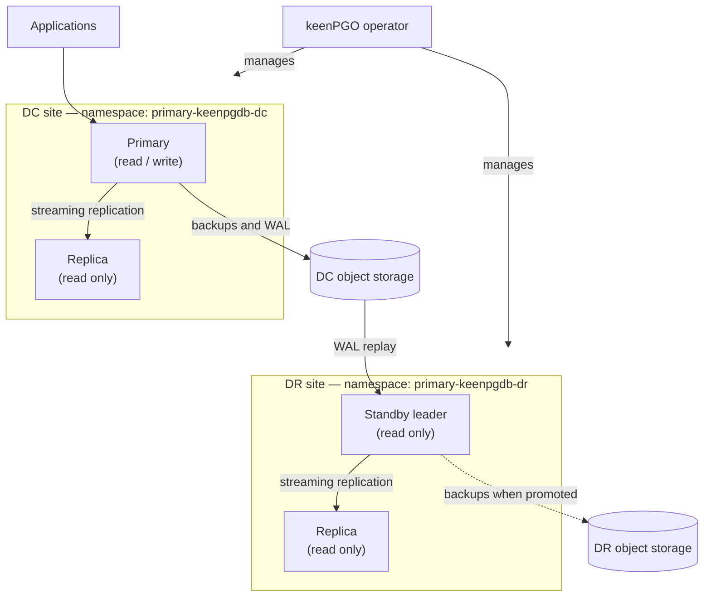
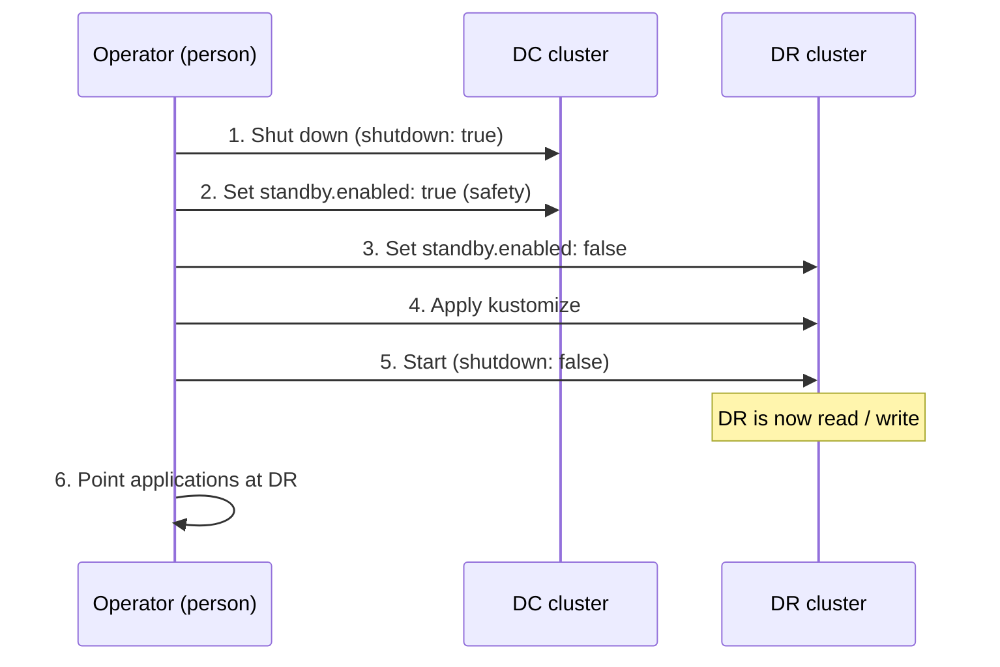
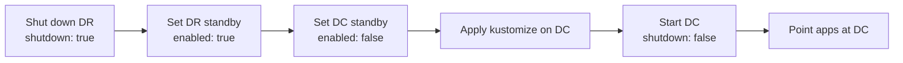

# Disaster recovery (DC / DR) setup

This page explains how keenPGO runs across a primary data centre (DC) and a
disaster recovery site (DR), how data flows between them, and the exact
steps to move the active database from DC to DR and back again.

## Who this page is for

- **Platform engineers** setting up the DC and DR clusters
- **DBAs** running a planned switchover or an unplanned failover to DR
- **On-call engineers** who need a step-by-step runbook during an incident

## Architecture overview

A single **keenPGO operator** manages everything. Each site runs its own
PostgreSQL cluster and has its own object storage:

- **DC** is the active site. Its cluster runs as a normal primary cluster
  (read / write) with a replica.
- **DR** runs the same layout, but as a **standby cluster**. It is read only
  and continuously replays changes from the DC object storage.



### Components

| Component | Location | Role |
|---|---|---|
| **keenPGO operator** | Top level | Watches both cluster definitions and creates, updates, shuts down and promotes them. |
| **DC cluster** | `primary-keenpgdb-dc` | Active cluster: one primary (read / write) and one replica (read only). |
| **DR cluster** | `primary-keenpgdb-dr` | Same layout, running in standby mode: a standby leader and a replica, both read only. |
| **DC object storage** | DC site | Holds DC base backups and archived WAL. The DR cluster reads from it. |
| **DR object storage** | DR site | Holds DR backups and WAL once DR becomes the active site. |

### Which site is active

The `standby` block in each cluster resource decides the role of that site.

| State | DC `standby.enabled` | DR `standby.enabled` | Writes go to |
|---|---|---|---|
| Normal operation | `false` | `true` | DC |
| Running on DR | `true` | `false` | DR |

DC cluster resource during normal operation:

```yaml
spec:
  standby:
    enabled: false
```

DR cluster resource during normal operation:

```yaml
spec:
  standby:
    enabled: true
    repoName: <repo that points at DC object storage>
```

!!! warning "Only one site may have `standby.enabled: false`"
    If both sites run as primary at the same time, both accept writes and
    the data diverges (split brain). Every procedure below shuts down the
    old primary **before** promoting the other side.

## Switch from DC to DR

Use this for planned maintenance or when the DC site is lost.



### 1. Shut down the DC cluster

```bash
kubectl patch keenpg-operator/primary-keenpgdb-instance -n primary-keenpgdb-dc \
  --type merge --patch '{"spec":{"shutdown": true}}'
```

Confirm that no DC database pods are running before you continue:

```bash
kubectl get pods -n primary-keenpgdb-dc
```

!!! note
    If the DC site is completely unreachable, this step cannot run. Make sure
    the DC cluster cannot come back as a primary on its own (for example,
    isolate it from the network) before promoting DR.

### 2. Set DC to standby (safety)

In the DC kustomize overlay, set:

```yaml
spec:
  standby:
    enabled: true
```

Apply it so that if the DC cluster is started again, it comes back read only
instead of as a second primary:

```bash
kubectl apply -k <dc-kustomize-path>
```

### 3. Promote DR

In the DR kustomize overlay, set:

```yaml
spec:
  standby:
    enabled: false
```

### 4. Apply kustomize on DR

```bash
kubectl apply -k <dr-kustomize-path>
```

### 5. Make sure the DR cluster is running

```bash
kubectl patch keenpg-operator/primary-keenpgdb-instance -n primary-keenpgdb-dr \
  --type merge --patch '{"spec":{"shutdown": false}}'
```

### 6. Verify and redirect applications

```bash
kubectl get pods -n primary-keenpgdb-dr
```

- Confirm the DR leader is now a primary and accepts writes
- Point applications (DNS, service, connection pool) at the DR primary service
- Confirm backups and WAL now go to **DR object storage**

## Switch back from DR to DC

Use the same method in reverse once the DC site is healthy.



!!! warning "Resync DC first"
    While DR was active, DC missed every write. Before switching back, DC
    must have caught up from DR object storage, or have been rebuilt from a
    fresh DR backup. Otherwise data written on DR is lost.

### 1. Shut down the DR cluster

```bash
kubectl patch keenpg-operator/primary-keenpgdb-instance -n primary-keenpgdb-dr \
  --type merge --patch '{"spec":{"shutdown": true}}'
```

### 2. Set DR back to standby (safety)

```yaml
spec:
  standby:
    enabled: true
    repoName: <repo that points at DC object storage>
```

```bash
kubectl apply -k <dr-kustomize-path>
```

### 3. Promote DC

```yaml
spec:
  standby:
    enabled: false
```

### 4. Apply kustomize on DC

```bash
kubectl apply -k <dc-kustomize-path>
```

### 5. Start the DC cluster

```bash
kubectl patch keenpg-operator/primary-keenpgdb-instance -n primary-keenpgdb-dc \
  --type merge --patch '{"spec":{"shutdown": false}}'
```

### 6. Verify and return to normal operation

- Confirm the DC primary accepts writes
- Point applications back at the DC primary service
- Start the DR cluster again so it follows DC as a standby:

    ```bash
    kubectl patch keenpg-operator/primary-keenpgdb-instance -n primary-keenpgdb-dr \
      --type merge --patch '{"spec":{"shutdown": false}}'
    ```

## Quick reference

| Step | DC → DR | DR → DC |
|---|---|---|
| 1 | Shut down DC | Shut down DR |
| 2 | DC `standby.enabled: true` | DR `standby.enabled: true` |
| 3 | DR `standby.enabled: false` | DC `standby.enabled: false` |
| 4 | `kubectl apply -k` on DR | `kubectl apply -k` on DC |
| 5 | DR `shutdown: false` | DC `shutdown: false` |
| 6 | Apps → DR | Apps → DC, start DR as standby |

## DR checklist

- [ ] keenPGO operator can manage both `primary-keenpgdb-dc` and `primary-keenpgdb-dr`
- [ ] DC cluster has `standby.enabled: false`, DR cluster has `standby.enabled: true`
- [ ] DC and DR object storage both configured and reachable from the DR site
- [ ] DR standby is replaying WAL with acceptable lag
- [ ] Application connection strings can be switched to DR quickly
- [ ] DC → DR → DC switchover rehearsed in a test environment
- [ ] [Backups](../backups.md) and [monitoring](monitoring.md) cover both sites
