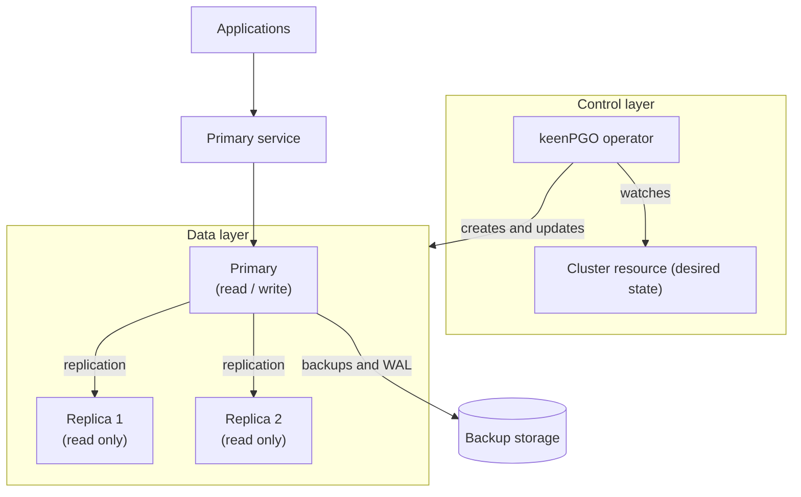
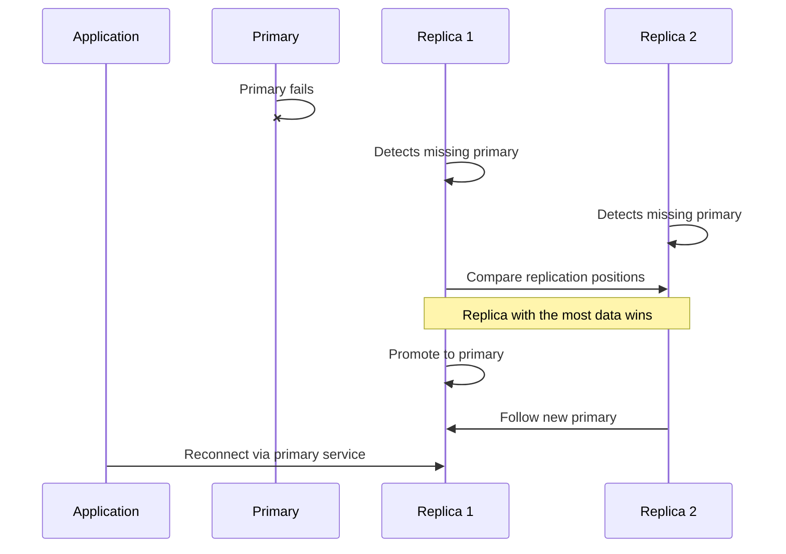
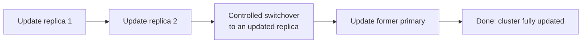

# High availability and architecture

This page explains how a keenPGO cluster is put together, how it survives
failures, and how to configure it for the level of protection you need.

## Who this page is for

- **Platform engineers** deciding how many instances to run and where to place them
- **DBAs** choosing between asynchronous and synchronous replication
- **Application developers** who need to know what happens to connections during a failover

## Architecture overview

A keenPGO deployment has two layers: a **control layer** that manages
desired state, and a **data layer** that serves your applications.



### Components

| Component | Role |
|---|---|
| **Operator** | Watches cluster definitions and creates, updates and repairs the resources they describe. It does not sit in the data path. |
| **Cluster resource** | Your declaration of what you want: PostgreSQL version, number of instances, storage, placement rules. |
| **Primary instance** | The one instance that accepts writes. |
| **Replica instances** | Continuously copy changes from the primary and can be promoted if it fails. |
| **Primary service** | A stable address that always points at the current primary, so applications don't need to know which pod it is. |
| **Backup storage** | Object or volume storage holding base backups and archived write-ahead logs. |


### Design principle: the operator is not a single point of failure

Once a cluster is running, patroni is responsible for failover. If the operator is down:

- Running clusters keep serving traffic
- Failover still happens
- Changes to cluster definitions wait until the operator returns

## What keenPGO protects against

| Problem | What happens |
|---|---|
| Primary pod crashes | A replica is promoted automatically |
| Node hosting the primary fails | A replica on another node is promoted |
| A replica fails | The cluster keeps running and the replica is rebuilt |
| Operator unavailable | Existing clusters keep running, as described above |
| Planned maintenance | Handled one instance at a time, see [Maintenance without downtime](#maintenance-without-downtime) |

!!! note "Limits of high availability"
    Replication protects against failures, not mistakes. A dropped table is
    dropped on every replica. Keep [backups](../backups.md), and see
    [disaster recovery](dr.md) for protection against loss of a whole site.

    Availability is also bounded by the platform underneath. If Kubernetes
    itself or its storage layer fails, the database is affected too.

## How failover works



1. **Detection.** `<How a failed primary is noticed and how long keenPGO waits before acting>`
2. **Selection.** `<How the best replica is chosen, for example the most up-to-date one>`
3. **Promotion.** `<How the replica becomes the primary>`
4. **Redirection.** The primary service now points at the new primary, so
   applications reconnect to the same address.
5. **Recovery.** `<What happens when the old primary returns: rewound, rebuilt, or rejoined as a replica>`

Typical failover time: `<value, and the conditions under which you measured it>`.

!!! tip "Make applications failover-friendly"
    Connections drop during failover. Use a driver or connection pool that
    retries, set sensible connection timeouts, and keep transactions short.
    Done well, users never notice.

## Choose a cluster layout

| Environment | Instances | Placement | Replication |
|---|---|---|---|
| Development | 1 | Any | Not applicable |
| Production | 3 | Separate nodes | Asynchronous |

Set the number of instances in the cluster resource:

```yaml
spec:
  instances:
    - name: instance1
      replicas: 3
      minAvailable: 1
  proxy:
    pgBouncer:
      replicas: 3
      minAvailable: 1
```


### Pod anti-affinity

Anti-affinity tells Kubernetes not to put all instances of the same cluster
together. Which means we highly recommend to use different node for each instance of same cluster.


### Node affinity

Node affinity places instances on nodes with particular labels. Typical uses:

- Fast local storage or high-memory nodes for the primary
- Keeping a replica in a specific nodesets
- Isolating databases from other workloads which means dedicated nodes for DB instance in production.

```yaml
spec:
  # <node affinity setting>
```

### Tolerations

Kubernetes Tolerations can help with the scheduling of Pods to appropriate nodes. There are many reasons that a Kubernetes administrator may want to use tolerations, such as restricting the types of Pods that can be assigned to particular Nodes. Reasoning and strategy for using taints and tolerations is outside the scope of this documentation. 

```yaml
spec:
  # <tolerations setting>
```


## Maintenance without downtime

### Rolling restarts

Some PostgreSQL settings only apply after a restart. Restarting everything
at once would cause an outage, so keenPGO works through the cluster in order:



1. Each replica is stopped cleanly, updated and restarted, and must be
   healthy before the next one begins.
2. The primary role is handed to an updated replica in a planned switchover.
3. The former primary is updated and rejoins as a replica.

Applications see one short reconnect, not an outage. keenPGO starts this
process automatically when it detects a change that needs a restart.

### Pod disruption budgets

When administrators drain nodes or upgrade Kubernetes, pods are evicted on
purpose. A pod disruption budget (PDB) states how many database pods must
stay available during such events.

```yaml
spec:
  # <minimum available setting>
```

Default behaviour: `<explain the default for single-instance and multi-instance clusters>`.

!!! warning
    Don't set the minimum equal to your total instance count. Node
    maintenance would then be blocked indefinitely.

## Test failover before you need it

Run this in a test environment first.

1. Find the current primary:

    ```bash
    kubectl get pods -n <namespace> -l <primary-label-selector>
    ```

2. Delete that pod to simulate a crash:

    ```bash
    kubectl delete pod <primary-pod-name> -n <namespace>
    ```

3. Watch the cluster recover:

    ```bash
    kubectl get pods -n <namespace> --watch
    ```

4. Confirm that a different pod is now the primary and your application
   reconnected and kept working.

If something doesn't behave as expected, see [troubleshooting](../troubleshooting.md).

## Production checklist

- [ ] At least three instances
- [ ] Instances on separate nodes, ideally in separate nodes
- [ ] Synchronous replication where data loss is unacceptable
- [ ] A pod disruption budget below your instance count
- [ ] Applications and connection pools retry after connection loss
- [ ] Failover tested at least once
- [ ] [Backups](../backups.md) configured and a restore tested
- [ ] [Monitoring](monitoring.md) alerts on replica lag and failovers


