# KeenPG Console

The **KeenPG console** is a web page for running PostgreSQL on Kubernetes and OpenShift. From your browser you can create databases, connect applications, take backups and restore them, run SQL and watch the health of every database. You never need to write YAML or use the command line.

This page explains every part of the console in simple words, with screenshots.

---

## Contents

- [How the console works](#how-the-console-works)
- [Words you will see](#words-you-will-see)
- [Install and open the console](#install-and-open-the-console)
- [Sign in](#sign-in)
- [The screen layout](#the-screen-layout)
- [Home](#home)
- [Create a cluster](#create-a-cluster)
- [Clusters list](#clusters-list)
- [Inside a cluster](#inside-a-cluster)
- [Connect your application](#connect-your-application)
- [Backup and restore](#backup-and-restore)
- [SQL Editor](#sql-editor)
- [Databases](#databases)
- [Observability](#observability)
- [Discovery](#discovery)
- [Migration](#migration)
- [Users and access](#users-and-access)
- [Other pages](#other-pages)
- [Common tasks](#common-tasks)
- [Troubleshooting](#troubleshooting)
- [Be careful](#be-careful)

---

## How the console works

```text
You (browser) ──► KeenPG console ──► Kubernetes ──► KeenPG operator ──► your PostgreSQL clusters
```

1. **You** fill a form or press a button in the console.
2. **The console** checks that you are allowed to do this. It then saves your request in Kubernetes as a `KeenPGCluster` object and writes an entry in the audit log.
3. **The KeenPG operator**, a program running inside your Kubernetes, sees the request. It creates everything the database needs: pods, disks, network services, passwords, certificates and backup jobs.
4. **The operator keeps watching.** If a pod crashes, a disk is lost or someone deletes a service by mistake, the operator puts it back.

Why this matters:

- **The console and the command line always agree.** For clusters, backups and settings, the console only writes the same objects you could write with `kubectl`. Only the **SQL Editor** and **Databases** pages talk to PostgreSQL directly, like any SQL tool.
- **Your databases don't depend on the console.** If the console stops, your databases keep running.
- **Your databases don't depend on the operator either.** If the operator stops, they keep running and failover still works. Only new changes wait until it is back.

---

## Words you will see

| Word | Meaning |
|---|---|
| **Project** | A group of databases. In Kubernetes this is a *namespace*, for example `apps` or `analytics`. |
| **Cluster** | One PostgreSQL database service: one primary and its replicas. |
| **Primary** (also *leader*) | The main server. All writes go here. |
| **Replica** (also *standby*) | A live copy of the primary. It can serve reads and takes over if the primary fails. |
| **Sync standby** | A replica that confirms every write before the primary says "done", so no data is lost if the primary fails. |
| **Failover** | A replica becomes the primary **automatically** because the primary stopped. |
| **Switchover** | You move the primary role to a replica **on purpose**, for example before maintenance. |
| **Lag** | How far a replica is behind the primary. `0 B` means fully up to date. |
| **Patroni** | The tool inside each pod that chooses the primary and handles failover. |
| **pgBackRest** | The backup tool. |
| **Repository (repo)** | Where backups are kept: a disk inside Kubernetes, or object storage (S3, GCS, Azure). |
| **Point-in-time restore** | Restoring a database to an exact moment, for example "yesterday at 10:15". |
| **PgBouncer** | A connection pooler. Many application connections share a few database connections. |
| **Secret** | A safe place in Kubernetes for passwords, keys and certificates. |

---

## Install and open the console

> **Skip this part** if KeenPG is already installed for you.

1. **Get the installation files.**
   ```bash
   git clone -b keenpgo-ui-6.0 https://github.com/keenpg/keenpg-operator.git
   cd keenpg-operator
   ```

2. **Add the image registry login.** The KeenPG images are private, so Kubernetes needs your login to download them. Use the robot account you got from KeenPG.
   ```bash
   podman login quay.io --authfile config/keenpg/pull-secret.json
   cat config/keenpg/pull-secret.json      # must show "quay.io", not {}
   ```
   If you skip this, databases will not start and show **ImagePullBackOff**.

3. **Install everything with one command.** This installs the operator, the console, the console's own small database, and every Secret needed.
   ```bash
   kubectl apply --server-side -k config/keenpg
   kubectl -n keenpg-operator get pods      # wait until every pod is Running
   ```

4. **Open the console** at `http://<node IP>:30080`. On minikube:
   ```bash
   minikube service keenpgo-console -n keenpg-operator --url
   ```

---

## Sign in

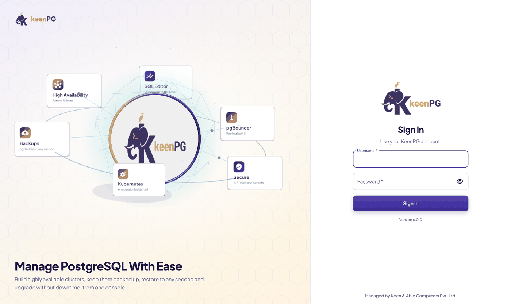

1. Open the console address in your browser.
2. Type your **username** and **password**, then click **Sign In**.
3. **First sign-in after install:** username `admin`, password `admin`.

> **Change the admin password on day one.** Click your name (top right) → **Change password**.

You stay signed in for 12 hours. To sign out, click your name → **Sign out**.

---

## The screen layout

Every page has the same frame:

| Area | What it does |
|---|---|
| **Left menu** | Opens each page. On small screens it shows only icons; click **»** at the bottom to open it. |
| **Project** (top left) | Chooses the project you are working in. Most pages show only that project's clusters. |
| **Create cluster** (top right) | Starts a new database from any page. |
| **Your name** (top right) | Change your password, manage users (admins only), sign out. |

You see only the pages and buttons your role allows. See [Users and access](#users-and-access).

---

## Home

The Home page is your daily check: in one look you see whether everything is fine.

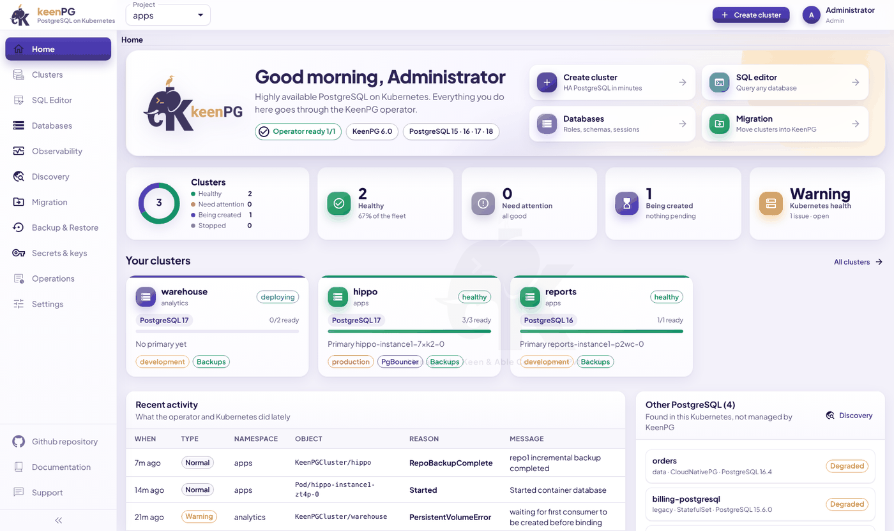

**Top card**

- **Operator ready 1/1** means the KeenPG operator is running.
- The chips show the **PostgreSQL versions** you can use.
- The four shortcuts open **Create cluster**, **SQL editor**, **Databases** and **Migration**.

**Count cards**

| Card | Meaning |
|---|---|
| **Clusters** ring | All clusters, split by state. |
| **Healthy** | Clusters with every pod ready. |
| **Need attention** | Clusters with a problem. Open them first. |
| **Being created** | New clusters that are still starting. |
| **Kubernetes health** | Problems in Kubernetes itself, for example a node that is not ready. |

**Your clusters**

One card per cluster. Each card shows:
- the PostgreSQL version;
- how many pods are ready (for example `3/3 ready`);
- the current primary;
- labels such as **production**, **PgBouncer** or **Backups**.

Click a card to open the cluster.

Lower on the page, **Recent activity** lists what happened lately (for example "backup completed"). **Other PostgreSQL** lists databases in your Kubernetes that KeenPG does not manage yet.

---

## Create a cluster

Click **Create cluster** (top right). The form has 9 numbered steps. While you fill it, the **Summary** on the right shows what you will get.

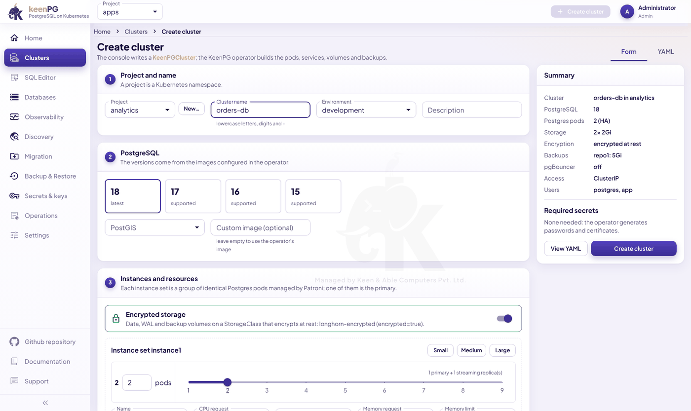

**Step 1: Project and name**

- **Project:** where the cluster will live. Click **New…** to make a new project.
- **Cluster name:** lowercase letters, digits and `-`, for example `orders-db`. You can't change it later.
- **Environment:** development, staging or production. This is a label that helps you sort and find clusters.
- **Description:** optional, for example "orders and payments".

**Step 2: PostgreSQL**

- Pick the **version** (15, 16, 17 or 18). Use the newest unless your application needs an older one.
- **PostGIS:** pick a version only if you store maps or locations.
- **Custom image:** leave it empty. KeenPG then uses its own tested image.

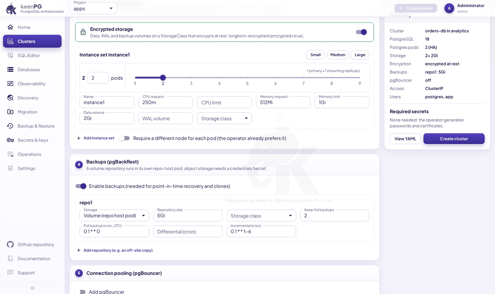

**Step 3: Instances and resources**

- **Encrypted storage** turns on by itself when your Kubernetes has encrypting disks.
- **Pods:** how many PostgreSQL servers you get.
  - `1` = a single server, with **no automatic failover**. Fine for testing.
  - `2` or more = one primary plus replicas, with **automatic failover**. **Use this for production.**
- **Size:** click a preset (table below), or type your own values.
- **Require a different node for each pod** puts each copy on a different machine, so one broken machine can't take down every copy.

| Preset | CPU | Memory | Disk |
|---|---|---|---|
| Small | 0.25 | 512 MiB | 2 GiB |
| Medium | 1 | 2 GiB | 20 GiB |
| Large | 4 | 8 GiB | 100 GiB |

**Step 4: Backups**

- Keep **Enable backups** on. Without backups you can't restore or clone.
- **Storage:** a *volume* (a disk inside Kubernetes) or *object storage* (S3, GCS, Azure). Object storage needs a credentials Secret first, from **Secrets & keys**.
- **Schedules** use cron format, in UTC:
  - **Full:** a complete copy;
  - **Differential:** changes since the last full backup;
  - **Incremental:** changes since the last backup of any type.

  For example, `0 1 * * 0` means every Sunday at 01:00.
- **Keep full backups:** how many full backups to keep. Older ones are removed automatically.

**Steps 5 to 9 (optional)**

| Step | What to set |
|---|---|
| **5. Connection pooling** | Turn on **pgBouncer** if your application opens many connections. |
| **6. Network, security, monitoring** | **ClusterIP** = reachable only inside Kubernetes. **NodePort / LoadBalancer** = reachable from outside. Also: metrics sidecar, extra image pull secrets, your own TLS certificate. |
| **7. Users and databases** | Each user gets a database and a generated password. Keep **Also create the postgres superuser Secret** on to use the SQL editor with full rights. |
| **8. PostgreSQL parameters** | Settings such as `max_connections`. Leave the defaults if you aren't sure. |
| **9. Initial data** | Start empty, or start from another cluster's backup, optionally at a point in time. |

**Finish:** check the **Summary**, optionally click **View YAML** to see the exact definition, then click **Create cluster**.

The new cluster shows **deploying** and is usually ready in 2 to 5 minutes. The first time can take longer, because the images are downloaded.

> **No passwords to prepare.** The Summary shows **Required secrets: None needed**. The operator creates every password and certificate by itself.

---

## Clusters list

Click **Clusters** in the menu to see every cluster in the current project.

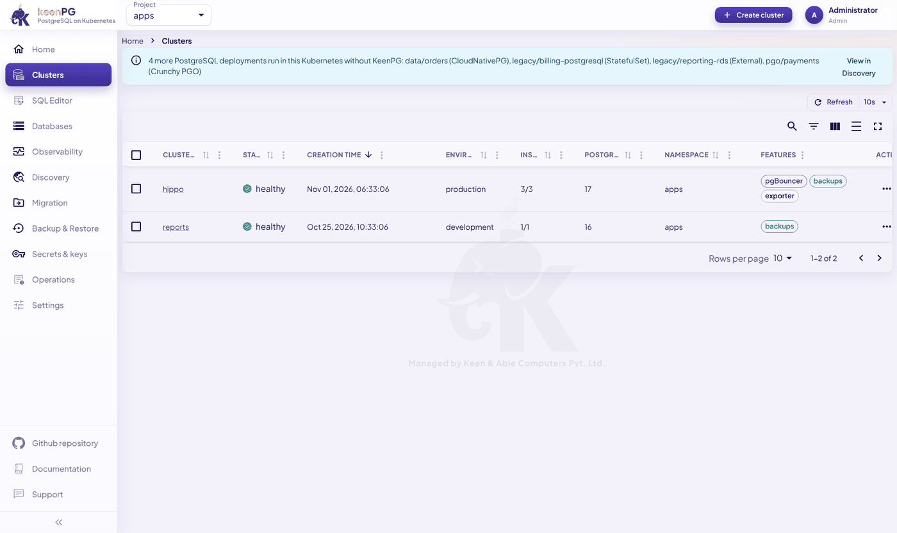

| Column | Meaning |
|---|---|
| **Cluster** | The name. Click it to open the cluster. |
| **Status** | `healthy`, `deploying`, `degraded` or `stopped`. |
| **Environment** | The label you chose (development, production…). |
| **Instances** | Ready pods / total pods, for example `3/3`. |
| **PostgreSQL** | Major version. |
| **Features** | Backups, PgBouncer and so on. |

The list refreshes every 10 seconds. Use the icons above the table to search, filter or choose columns.

---

## Inside a cluster

Open a cluster to see everything about it. The header shows its health, environment, project, version and current primary. The page has 8 tabs.

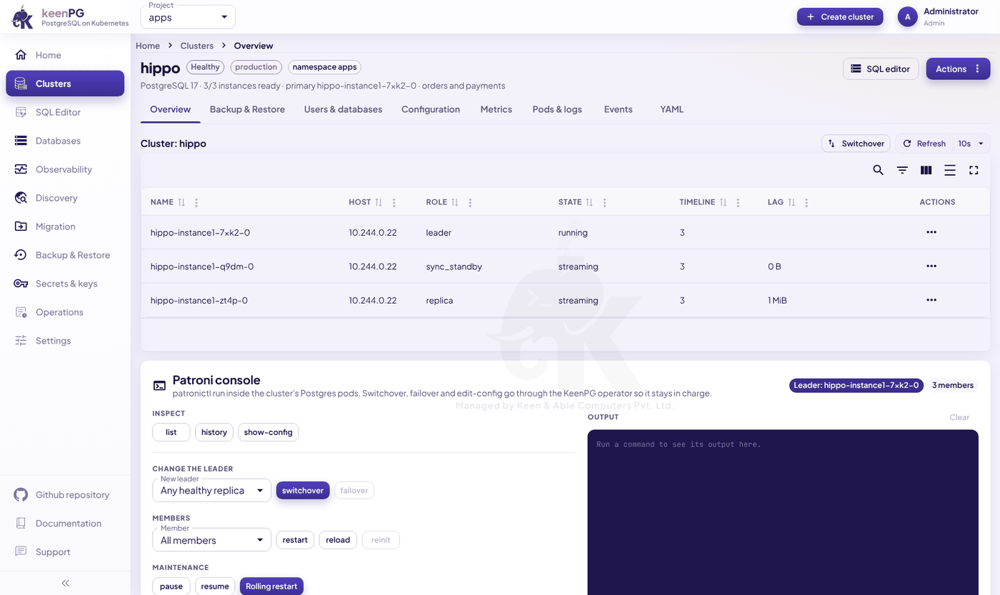

### The tabs

| Tab | What it shows and what you can do |
|---|---|
| **Overview** | Every member with its **role** (leader, sync_standby, replica), **state** and **lag**, plus the Patroni console (below). |
| **Backup & Restore** | Backup schedules, the list of backups, and the backup jobs. See [Backup and restore](#backup-and-restore). |
| **Users & databases** | Users the operator manages, with **Connection**, **Edit**, **Add user** and remove. |
| **Configuration** | PostgreSQL parameters and extra `pg_hba` access rules. Click **Save** to apply. |
| **Metrics** | Uptime, connections, cache hit rate, replication lag, database sizes and the longest-running queries. |
| **Pods & logs** | Every pod with its status and restarts. **Logs** opens a pod's log. **Delete** recreates a stuck pod. |
| **Events** | What Kubernetes and the operator reported, newest first. **Look here first when something is wrong.** |
| **YAML** | The full cluster definition. Advanced users can edit it and click **Save**. |

### Reading the members table

- **leader** is the primary.
- **sync_standby** is a replica that has every write.
- **replica** is a normal copy.
- **State** should be `running` for the leader and `streaming` for the others.
- **Lag** of `0 B` means up to date. A large, growing lag means a replica is falling behind.

### The Patroni console

The panel under the members table runs safe Patroni commands for you. The answer appears in **Output**.

| Button | What it does |
|---|---|
| **list / history / show-config** | Show the members, past leader changes, and the current settings. |
| **switchover** | Moves the leader to a healthy replica, with a short pause in writes. |
| **failover** | Forces a new leader. **Only for emergencies**, when the leader is unhealthy. |
| **restart / reload** | Restarts a member, or reloads its settings without a restart. |
| **reinit** | Rebuilds a broken replica from scratch from the leader. |
| **pause / resume** | Turns automatic failover off and on, for planned maintenance. |
| **Rolling restart** | Restarts every member one by one, replicas first. |

### The Actions menu

Click **Actions** (top right of the cluster page).

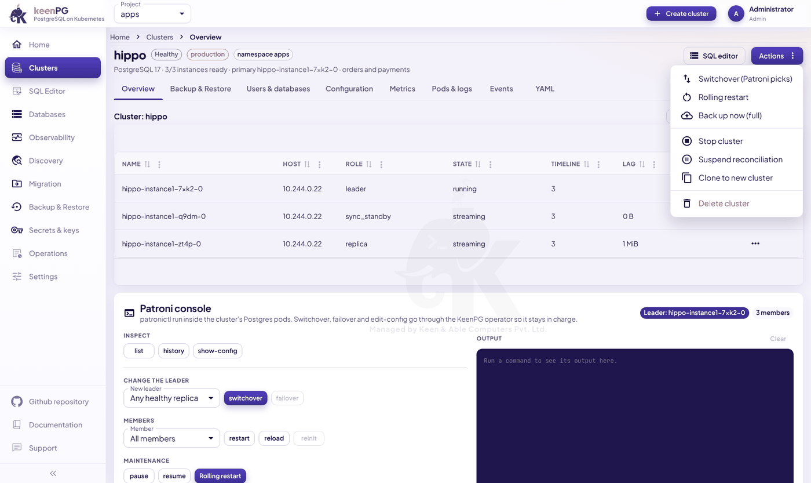

| Action | What happens |
|---|---|
| **Switchover (Patroni picks)** | Patroni moves the primary to the best replica. Applications reconnect within seconds. |
| **Rolling restart** | All pods restart one at a time, replicas first. Use it after a setting that needs a restart. |
| **Back up now (full)** | Starts a full backup immediately. |
| **Stop cluster** | Shuts down all PostgreSQL pods to save resources. **Data is kept.** **Start cluster** brings it back. |
| **Suspend reconciliation** | The operator stops managing this cluster: it neither changes nor repairs it. Use only for short maintenance. **Resume** to continue. |
| **Clone to new cluster** | Makes a new cluster from this one's backups. The original is not changed. |
| **Delete cluster** | Deletes the cluster, **its disks and the backups in its volume repositories**. You must type the name to confirm. **This can't be undone.** |

---

## Connect your application

Open the cluster → **Users & databases** → **Connection** next to the user.

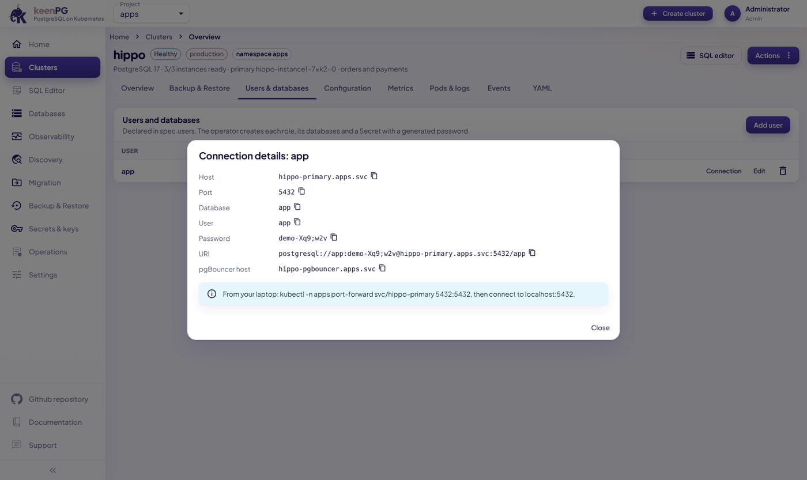

The window shows everything an application needs. Click the copy icon next to any value.

| Field | Example | Use |
|---|---|---|
| **Host** | `hippo-primary.apps.svc` | The address of the current primary. |
| **Port** | `5432` | The PostgreSQL port. |
| **Database / User** | `app` | What to connect to, and as whom. |
| **Password** | (generated) | Also stored in the Secret `<cluster>-pguser-<user>`. |
| **URI** | `postgresql://app:…@hippo-primary.apps.svc:5432/app` | A complete connection string you can paste. |
| **pgBouncer host** | `hippo-pgbouncer.apps.svc` | Use this instead of the host when PgBouncer is on. |

**From an application inside Kubernetes**, use the URI as shown. You can also read it from the Secret `<cluster>-pguser-<user>`, which has the keys `host`, `port`, `user`, `password`, `dbname`, `uri` and `jdbc-uri`.

**From your laptop**, forward the port first:
```bash
kubectl -n <project> port-forward svc/<cluster>-primary 5432:5432
psql "postgresql://<user>:<password>@localhost:5432/<database>"
```

> `<cluster>-primary` **always points to the current primary**, even right after a failover. Your application doesn't need to change anything.

---

## Backup and restore

Open **Backup & Restore** in the menu (or the cluster's **Backup & Restore** tab), and choose the cluster at the top right.

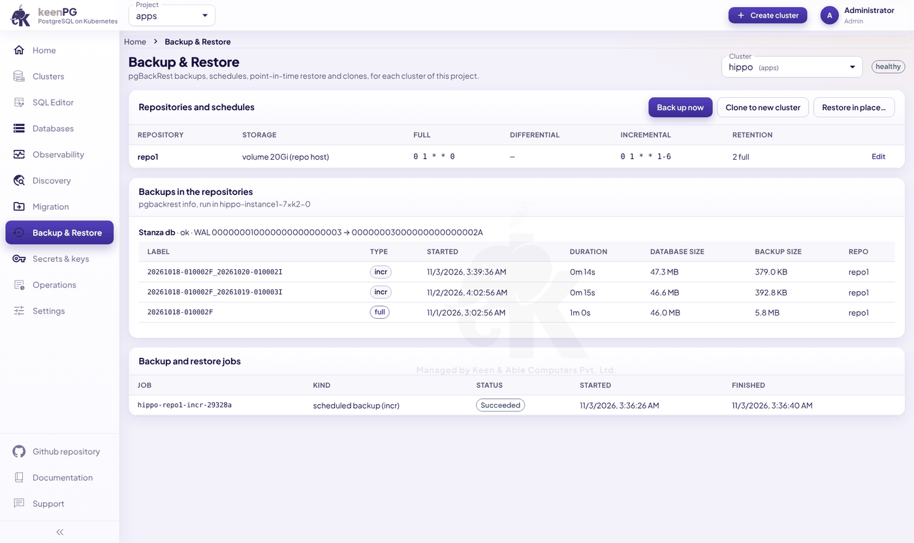

**What the page shows**

- **Repositories and schedules:** where backups go, when each type runs, and how many are kept. Click **Edit** to change them.
- **Backups in the repositories:** every backup with its type (`full`, `diff`, `incr`), start time, duration, database size and backup size.
- **Backup and restore jobs:** each run and whether it **Succeeded**.

**Take a backup now:** click **Back up now**. It appears under the jobs, then in the backup list when finished.

**Restore in place:** replaces **all** data in this cluster with a backup.

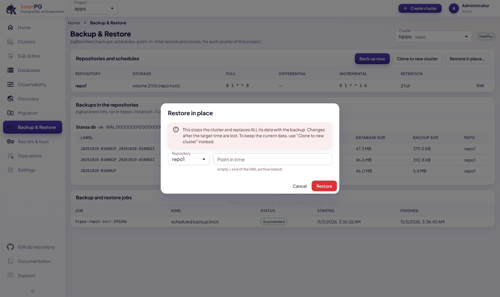

1. Click **Restore in place…**.
2. Choose the **Repository**.
3. In **Point in time**, type the moment to go back to, for example `2026-11-02 10:15:00+05:30`. Leave it empty to restore to the latest point possible.
4. Click **Restore**. The cluster stops, restores and starts again. Changes made after that moment are lost.

**Clone to new cluster:** the safe choice. The Create cluster form opens, already filled in, with the backup as its initial data. Pick a name and, if needed, a point in time, then click **Create cluster**. The original cluster is not touched.

Use a clone to:
- get back a table deleted by mistake: clone to just before the mistake, then copy the table back;
- test an upgrade or a risky change;
- give developers a copy of production.

---

## SQL Editor

Run SQL on any database straight from your browser.

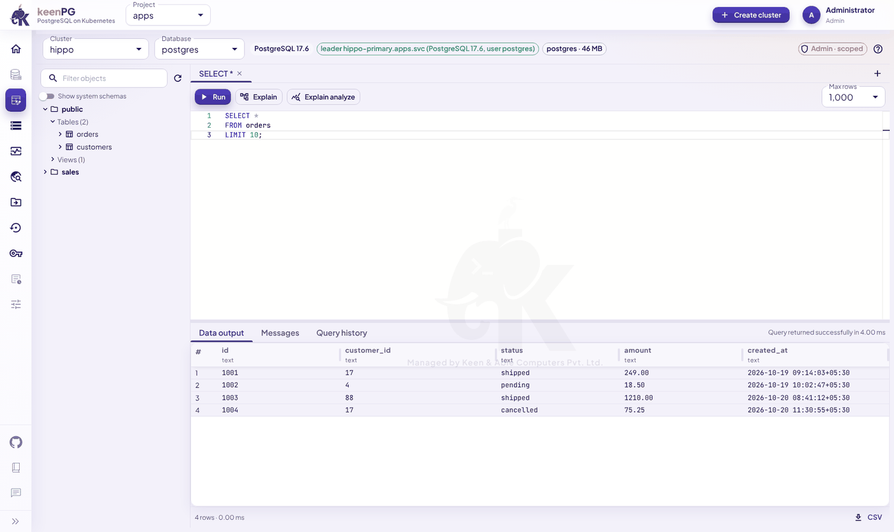

1. Choose the **Cluster** and the **Database** at the top.
2. Type your SQL. The left panel lists schemas, tables and views; click one to use its name.
3. Click **Run**, or press **F5** or **Ctrl+Enter**. To run only part of the text, select it first.
4. Results appear in **Data output**. Click **CSV** (bottom right) to download them.

More:

- **Explain** and **Explain analyze** show how PostgreSQL runs a query, to help you make it faster.
- **Messages** shows notices and errors. **Query history** shows what you ran before.
- **+** opens another query tab. **Max rows** limits how many rows come back.
- The badge at the top right shows your access, for example **Admin · scoped**. Read-only users can only run queries that don't change data.
- **Every query is recorded in the audit log.**

---

## Databases

The **Database manager** lets you manage what is *inside* a cluster without writing SQL. Choose the **Cluster** and **Database** at the top right.

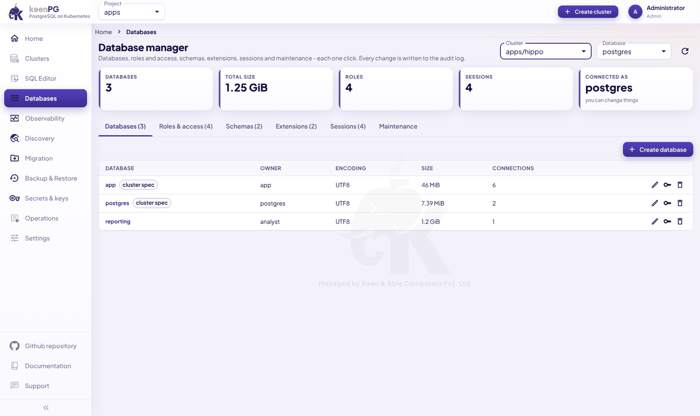

The cards show the number of databases, total size, roles, open sessions, and which user the page is connected as.

| Tab | What you can do |
|---|---|
| **Databases** | Create, rename, change owner, drop. |
| **Roles & access** | Create users and groups, set passwords and expiry dates, and grant access per schema (connect / read / write / all). |
| **Schemas** | Create and drop schemas. |
| **Extensions** | Install, update or remove extensions such as `pg_stat_statements`. |
| **Sessions** | See who is connected and what they run. Cancel a query, or disconnect a session. |
| **Maintenance** | Run **VACUUM**, **ANALYZE**, **VACUUM FULL** or **REINDEX**, and see the largest tables with their dead rows. |

> Items marked **cluster spec** were created in the Create cluster form and are managed by the operator. Change those on the cluster's **Users & databases** tab instead.

---

## Observability

One page for the health of **all** your databases at once.

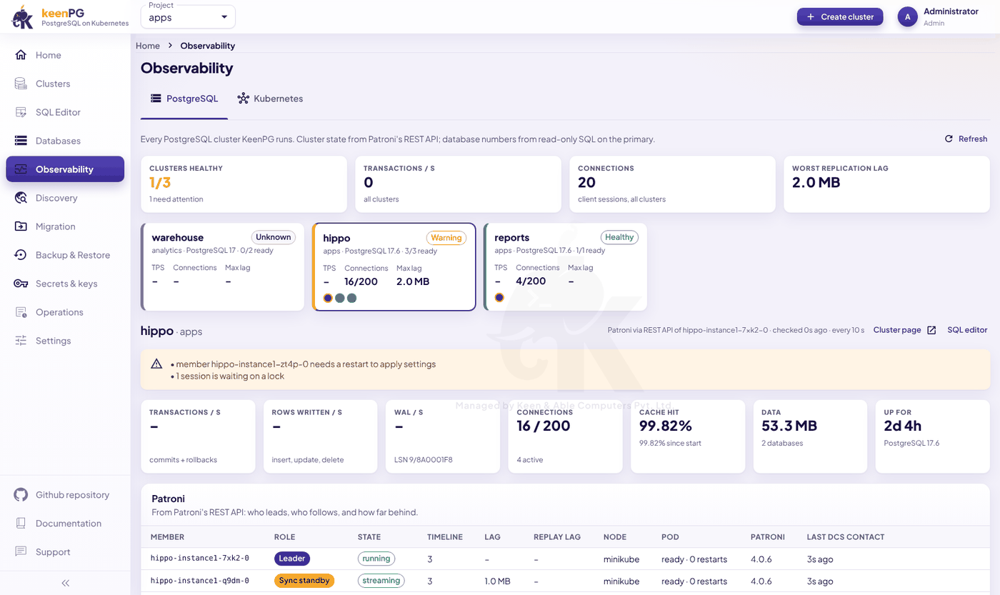

- **Top cards:**
  - how many clusters are healthy;
  - transactions per second across all clusters;
  - total connections;
  - the worst replication lag anywhere.
- **Cluster cards:**
  - each shows its state (**Healthy**, **Warning**, **Unknown**), connections and lag;
  - the coloured dots are its members;
  - click a card to see its details below.
- **Warnings** explain what needs attention, for example:
  - "member … needs a restart to apply settings";
  - "1 session is waiting on a lock".
- **Detail cards:** transactions, rows written, WAL, connections, cache hit rate, data size and uptime.
- **Patroni table:**
  - who leads and who follows;
  - each member's lag and restarts;
  - when each member last checked in.

The **Kubernetes** tab shows the health of nodes and system pods.

---

## Discovery

Discovery finds **other PostgreSQL databases** already running in your Kubernetes that KeenPG doesn't manage.

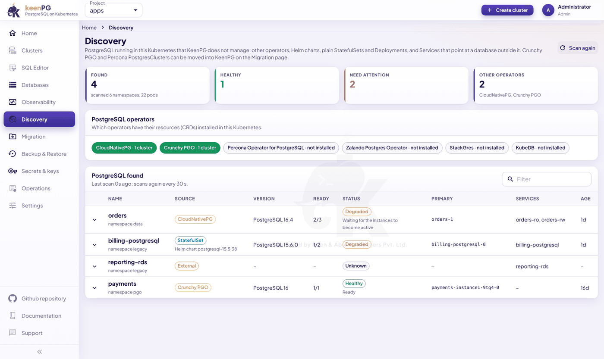

- **Top cards:** how many databases were found, and how many are healthy or need attention.
- **PostgreSQL operators:** which other operators are installed: CloudNativePG, Crunchy PGO, Percona, Zalando, StackGres, KubeDB.
- **PostgreSQL found:** each database with its source (an operator, a Helm chart, a plain StatefulSet, or an external service), version, ready pods, status, primary and services. Click the arrow for details.

Discovery scans again every 30 seconds. **Crunchy PGO** and **Percona** databases can be moved into KeenPG on the **Migration** page.

---

## Migration

Move databases from **Crunchy PGO** or **Percona** into KeenPG. KeenPG reads the source's own backups, so **the source database is never changed or stopped**.

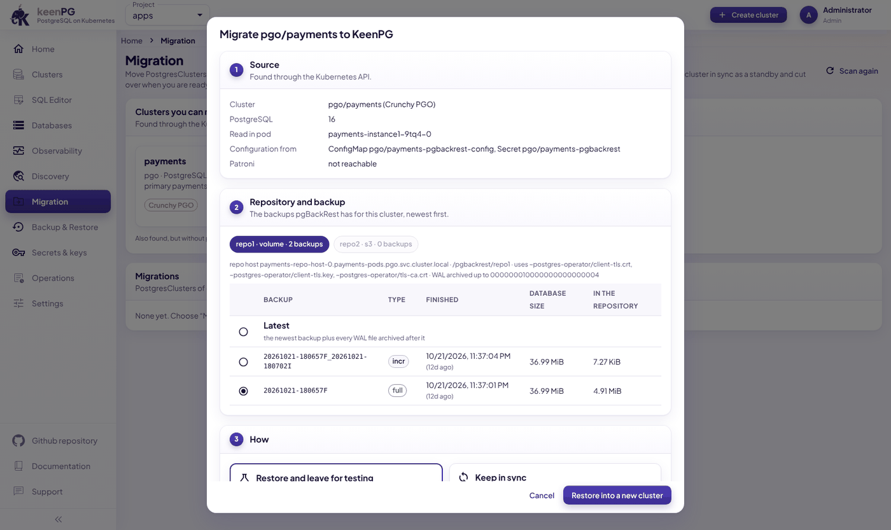

1. Open **Migration** and click **Migrate** on the cluster you want to move.
2. **Source:** check the details (cluster, version, pod).
3. **Repository and backup:** choose where to read backups from, and which backup. **Latest** means the newest backup plus every change after it.
4. **How:**
   - **Restore and leave for testing:** builds a new KeenPG cluster from the backup. The source keeps running. Use this to test first.
   - **Keep in sync:** the new cluster follows the source and keeps copying its changes. When you are ready to switch, click **Cut over**, and the new cluster becomes a normal primary.
5. Click **Restore into a new cluster**. Progress appears under **Migrations**.

The new cluster has the same PostgreSQL major version as the source.

---

## Users and access

**Settings → Users** lists everyone who can sign in to the console.

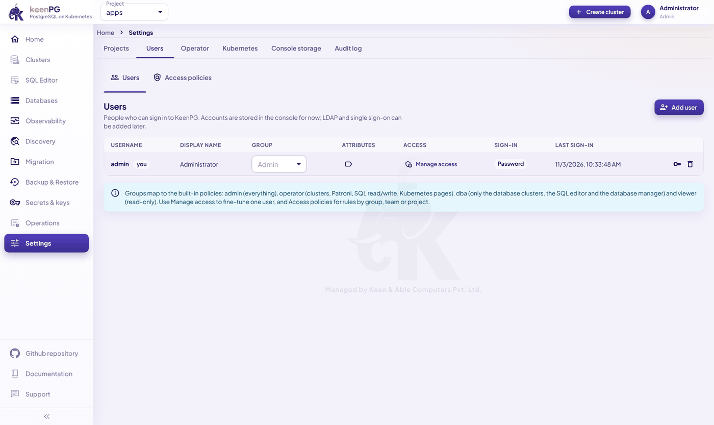

- **Add user:** create an account.
- **Group:** decides what the person can do (table below).
- **Manage access:** fine-tune one person. Allow or deny single permissions, or limit them to some projects.
- **Key icon:** reset the person's password. **Trash icon:** remove the person.

| Group | Can do |
|---|---|
| **Admin** | Everything: users, access policies, settings, audit log, SQL as superuser. |
| **Operator** | Create and run clusters, Patroni actions, backups, Secrets, Kubernetes pages, discovery and migration, SQL read/write. |
| **DBA** | Only the database clusters, the SQL editor (as superuser) and the database manager. No Kubernetes pages, Secrets or settings. |
| **Viewer** | Read only. |

The **Access policies** tab holds rules for groups, teams or single users, optionally limited to some projects, clusters or databases. **Deny wins over allow.** The Administrators policy can't be changed, so an admin can never lock themselves out.

---

## Other pages

| Page | What it is for |
|---|---|
| **Secrets & keys** | Create what some features need *before* you create a cluster: a **registry login** for private images, **S3 / GCS / Azure credentials** for backups, or a **TLS key pair**. Database passwords are not made here; the operator creates them. |
| **Operations** | All backup and restore jobs, and all events, for every cluster, in one list. **Warning** lines need attention. |
| **Settings → Projects** | The projects (namespaces) KeenPG uses. **Add project** makes a new one. |
| **Settings → Operator** | The operator's state and the image used for each PostgreSQL version and tool. |
| **Settings → Kubernetes** | Storage classes (disk types, and whether they can grow) and the nodes. |
| **Settings → Console storage** | The console's own small database (users, sessions, audit log) and its disk. Click **Increase size** if it fills up. |
| **Settings → Audit log** | Every change and every SQL query made in the console: when, who, what. Kept for 180 days by default. |

---

## Common tasks

| I want to… | Do this |
|---|---|
| Create a database for a new app | **Create cluster** → fill steps 1–7 → **Create cluster**. |
| Get my app's connection details | Cluster → **Users & databases** → **Connection**. |
| Back up before a risky change | Cluster → **Actions** → **Back up now (full)**. |
| Recover data deleted by mistake | **Backup & Restore** → **Clone to new cluster** → a time just before the mistake → copy the data back. |
| Add a replica | Cluster → **YAML** → raise `replicas` under `instances` → **Save**. |
| Change a PostgreSQL setting | Cluster → **Configuration** → change → **Save**. |
| Move the primary before maintenance | Cluster → **Actions** → **Switchover**. |
| Pause a test database to save resources | Cluster → **Actions** → **Stop cluster** (data is kept). |
| Find out why a cluster isn't healthy | Cluster → **Events**, then **Pods & logs**. |
| Find slow queries | Cluster → **Metrics** → longest-running queries, or **Databases** → **Sessions**. |
| Give a colleague read-only access | **Settings → Users** → **Add user** → group **Viewer**. |
| See who changed something | **Settings → Audit log**. |

---

## Troubleshooting

| What you see | What it means | What to do |
|---|---|---|
| Pods show **ImagePullBackOff** or **401 Unauthorized** | Kubernetes can't download the images. | The registry login is missing or wrong. Repeat install step 2, run `kubectl apply --server-side -k config/keenpg` again, then delete the stuck pods. |
| **manifest unknown** / **not found** | That image version doesn't exist in the registry. | Contact KeenPG support. |
| A pod stays **Pending**, or a **PersistentVolumeError** event | No disk could be created. | Check **Settings → Kubernetes** for a storage class with free space. |
| A **MissingRequiredImage** event | No image is set for that PostgreSQL version. | Choose a version offered in the Create cluster form. |
| The cluster stays **deploying** | Something is blocking the start. | Read the cluster's **Events** tab, then **Pods & logs**. |
| A replica's lag keeps growing | The replica is falling behind or stuck. | Overview → Patroni console → choose the member → **reinit**. |
| "No console database is configured" | The console's own database isn't running. | Check the pod `keenpgo-console-db-0` in the `keenpg-operator` project. |
| You can't sign in | Wrong or forgotten password. | Ask an admin to reset it in **Settings → Users** (key icon). |

Still stuck? Send this output to KeenPG support:

```bash
kubectl -n <project> get keenpgcluster <cluster> -o yaml
kubectl -n <project> get pods,pvc,events
kubectl -n keenpg-operator logs deploy/keenpgo --tail=200
```

---

## Be careful

- **Deleting a cluster is permanent.** It removes the cluster's disks and the backups in its volume repositories. Keep important backups in object storage too, or clone before you delete.
- **Restore in place replaces all data.** When in doubt, use **Clone to new cluster**.
- **Use 2 or more pods for production.** With one pod there is no automatic failover.
- **Keep backups on.** Without them you can't restore or clone.
- **Change the default admin password** on the first day.
- **Suspend reconciliation only for short maintenance.** While suspended, the operator doesn't repair the cluster.
